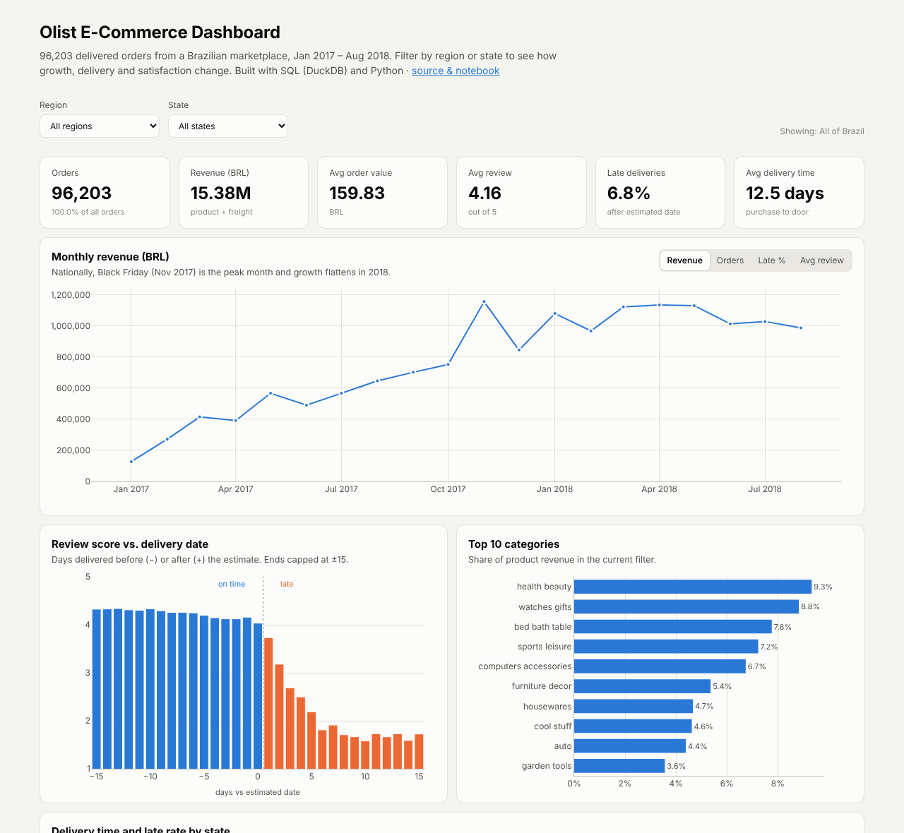
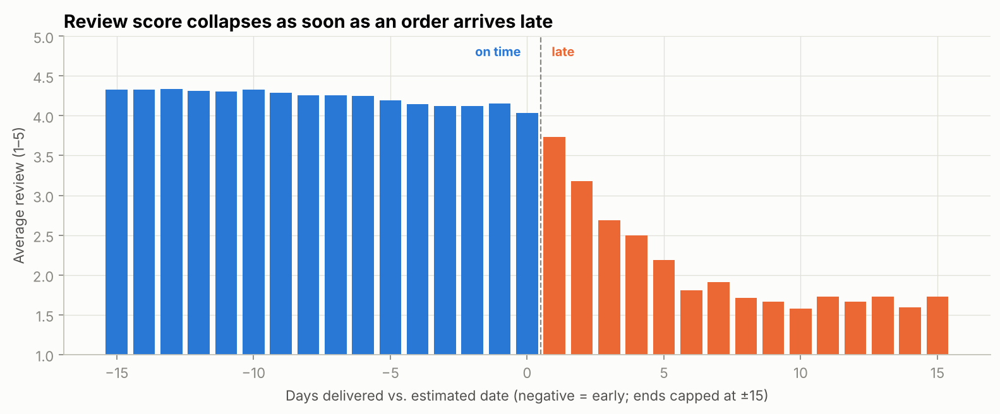
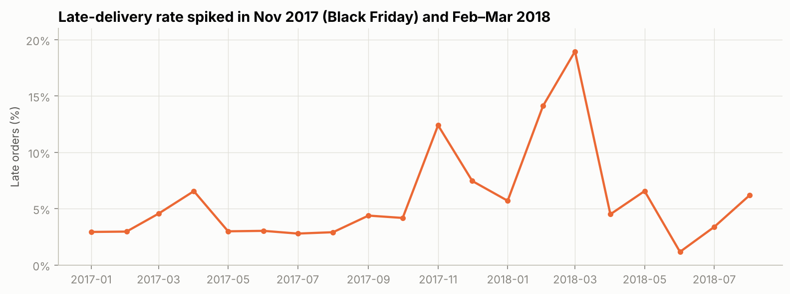
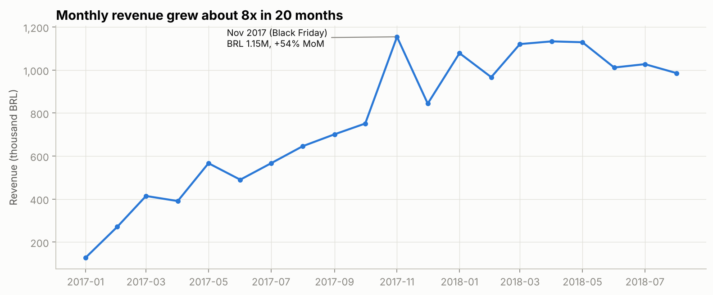
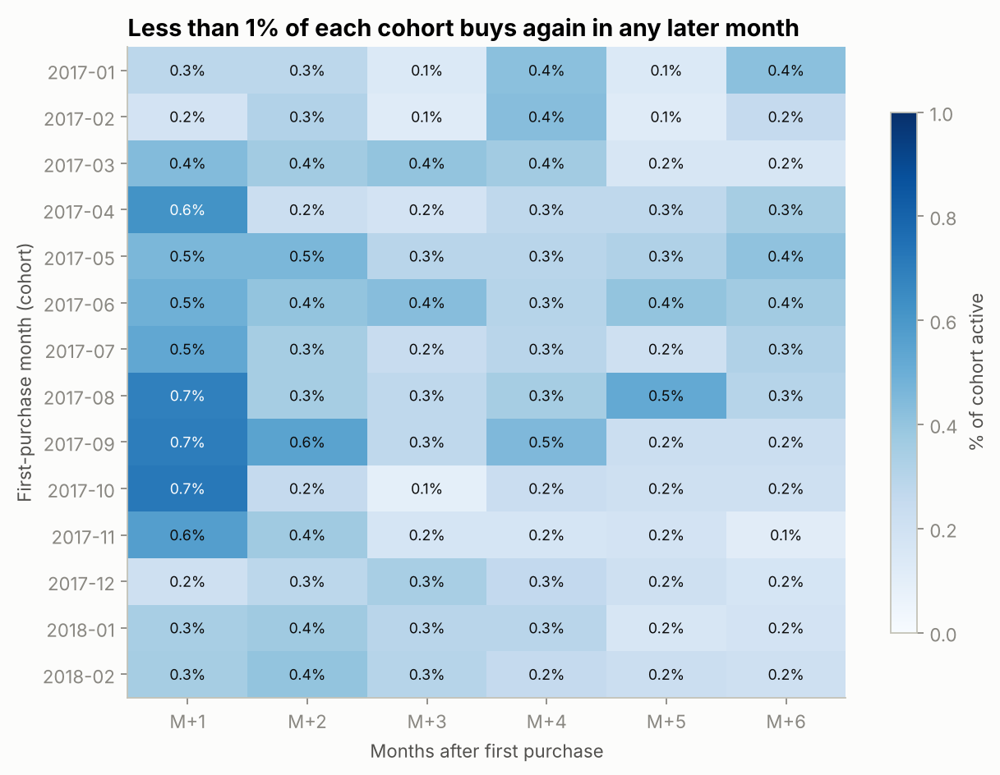
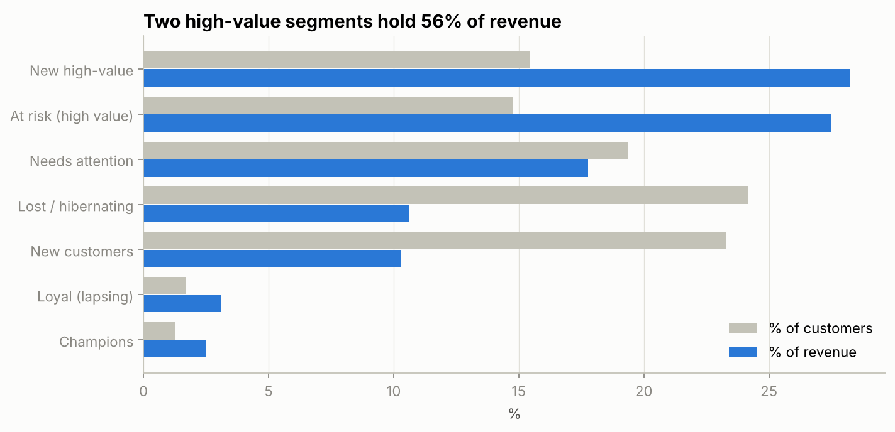
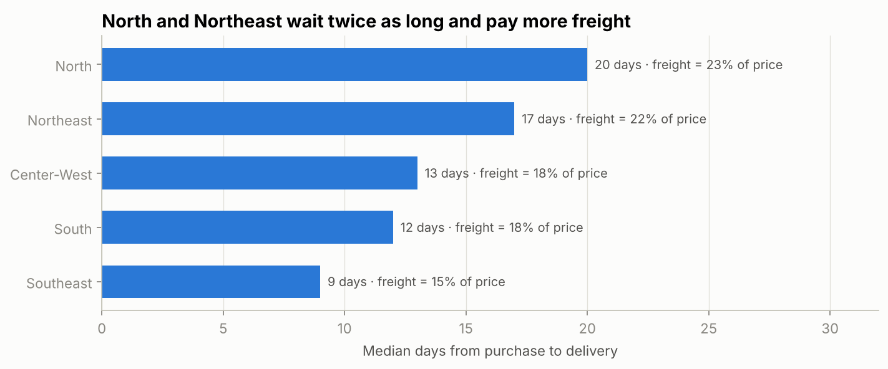

# Olist E-Commerce Analysis: Growth, Delivery & Customer Retention

End-to-end data analysis of **96,203 delivered orders** from Olist, a Brazilian online marketplace (Jan 2017 – Aug 2018).
SQL does the heavy lifting, Python turns the results into charts, and an interactive dashboard puts it all in one page.

**[▶ Open the interactive dashboard](https://mhmmdzul.github.io/olist-ecommerce-analysis/)** · [Read the notebook](notebooks/olist_analysis.ipynb) · [Browse the SQL](sql/)



## Business questions

1. How fast is the business growing, and when are the peaks?
2. Which product categories drive revenue?
3. Do late deliveries hurt customer satisfaction?
4. Which regions are hardest to serve?
5. Do customers come back?
6. Which customer segments should marketing target (RFM)?
7. How do customers pay?

## Key findings

| Metric | Value |
|---|---|
| Delivered orders | 96,203 |
| Unique customers | 93,096 |
| Revenue (product + freight) | BRL 15.38M |
| Average order value | BRL 159.83 |
| Average review score | 4.16 / 5 |
| Late deliveries | 6.8% |
| Customers who ever ordered twice | 3.0% |

**1. Late delivery is the main driver of bad reviews.** On-time orders average **4.29 stars**; late orders average **2.27**, and **62% of late orders get 1–2 stars** (vs 9% of on-time orders). The score drops on the first day past the estimate.



**2. Logistics breaks at demand peaks.** The late rate usually stays below 7%, but jumped to **12% in Nov 2017 (Black Friday)** and **14–19% in Feb–Mar 2018**, when the average review fell to 3.8.



**3. Growth stalled because almost nobody buys twice.** Monthly revenue grew from BRL 127K (Jan 2017) to about BRL 1M per month, then flattened through 2018. Only **3.0% of customers** placed a second order, and every monthly cohort retains **less than 1%** in later months.




**4. Two high-value segments hold ~56% of revenue.** RFM segmentation shows *New high-value* customers (recent, big spenders) and *At risk (high value)* customers (big spenders inactive for about a year) are each ~15% of customers but together bring 56% of revenue.



**5. North and Northeast are underserved.** Customers there wait a median **17–20 days** (vs 9 in the Southeast) and pay freight equal to **~22% of the product price** (vs 15%).



**6. Revenue is concentrated.** The top 10 of 74 categories bring **62.5%** of product revenue, led by health & beauty and watches & gifts. Credit card covers **78.5%** of payment value, with an average of 3.5 instalments.

## Recommendations

| Problem | Recommendation |
|---|---|
| Late orders get 2.3 stars | Set more conservative delivery estimates and notify customers early when an order will be late. |
| Late rate spikes at peaks | Plan carrier capacity and seller cut-off times ahead of Black Friday and other peaks. |
| 3% repeat rate | Post-purchase emails, second-order vouchers and a loyalty programme. |
| High-value segments | Second-order offer for *New high-value*; win-back campaign for *At risk*. |
| Slow, costly North/Northeast | Recruit sellers or use fulfilment hubs closer to these regions; test freight subsidies. |

## Approach

1. **Modelling (SQL).** [`00_setup.sql`](sql/00_setup.sql) loads the raw CSVs into DuckDB and builds one clean, order-level table: delivered orders only, complete months only (Jan 2017 – Aug 2018), customers identified by `customer_unique_id`, one review per order.
2. **Analysis (SQL).** Each question has its own query file, using joins, CTEs and window functions (`LAG`, `NTILE`, `ROW_NUMBER`, `SUM() OVER`).
3. **Visualisation (Python).** The [notebook](notebooks/olist_analysis.ipynb) runs the SQL files, draws the charts and writes up each insight.
4. **Dashboard.** [`scripts/export_dashboard_data.py`](scripts/export_dashboard_data.py) aggregates the data per state and month; [`docs/index.html`](docs/index.html) renders it with Plotly, with region/state filters.

```
olist-ecommerce-analysis/
├── data/raw/            # Olist CSVs (see data/README.md)
├── sql/                 # 00_setup + one query per business question
├── notebooks/           # olist_analysis.ipynb (analysis + charts)
├── scripts/             # export_dashboard_data.py
├── docs/                # interactive dashboard (GitHub Pages)
└── images/              # charts used in this README
```

## Run it yourself

```bash
git clone https://github.com/mhmmdzul/olist-ecommerce-analysis.git
cd olist-ecommerce-analysis
pip install -r requirements.txt

jupyter notebook notebooks/olist_analysis.ipynb   # analysis and charts
python scripts/export_dashboard_data.py           # rebuild dashboard data
```

Then open `docs/index.html` in a browser.

## Limitations

- The data is a public sample of Olist orders with no marketing, cost or profit data, so the findings show correlation, not causation.
- Revenue counts delivered orders only; cancelled and in-transit orders are excluded.
- Delivery estimates come from Olist's own system; how they were calculated is not known.

## Data source

[Olist Brazilian E-Commerce dataset](https://github.com/olist/work-at-olist-data) (MIT licence, © 2019 Olist), also on [Kaggle](https://www.kaggle.com/datasets/olistbr/brazilian-ecommerce).

---

**Muhammad Zul Rezky Zaaki** · [Portfolio](https://mzulrezky-portfolio.vercel.app) · [LinkedIn](https://linkedin.com/in/muhammadzulrezkyzaaki) · [GitHub](https://github.com/mhmmdzul)
